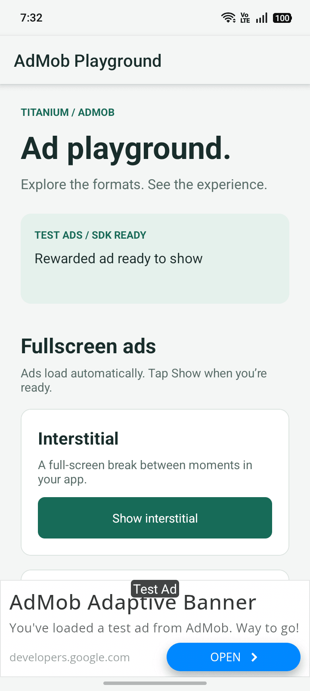

# ti.admob.unified

`ti.admob.unified` provides one Titanium JavaScript API for Google Mobile Ads and the User Messaging Platform (UMP) on iOS and Android.

Version `1.0.0` supports a consent-first startup flow and the same lifecycle and event payloads for banners, interstitials, rewarded ads, rewarded interstitials and app open ads on both platforms. Five optional mediation complements let your app include the networks it uses.

For migration from `ti.admob`, `ti.android.admob`, or an internal development build, see [Migrating to ti.admob.unified](documentation/migration.md). No earlier release of this module has been published.

Copy [`example/lib/ads.js`](example/lib/ads.js) to `app/lib/ads.js` in Alloy or `Resources/lib/ads.js` in Classic Titanium to use the application integration library. It sequences privacy and initialization, manages standard/adaptive banners and interstitial, rewarded, rewarded interstitial and app-open ads, and cleans up placements without refresh timers. See [Copy-ready JavaScript library](documentation/library.md).

<p align="center">
  <picture>
    <source media="(prefers-color-scheme: dark)" srcset=".github/screenshots/example-android-dark.png">
    
  </picture>
</p>

## One contract across platforms

Use the same factory names, configuration properties and event handlers on iOS and Android.

One module declaration in `tiapp.xml` covers both platforms:

```xml
<modules>
  <module version="1.0.0">ti.admob.unified</module>
</modules>
```

Factory names, properties and constants match across platforms, so each placement uses one call:

```js
const ad = Admob.createBanner({ adUnitId: unitId, adSize: Admob.BANNER })
```

Fullscreen ads are single-use on both platforms. Set `autoReload: true` to load the next ad after the current one closes.

Event names, payload keys and value types match on iOS and Android. Use the same handler on both:

```js
ad.addEventListener(Admob.AD_LOADED, event => {
  // adUnitId, adType, isAdaptive — same keys, same types, both platforms
})
```

[The roadmap](ROADMAP.md#differences-that-stay) describes the SDK differences and explains why they remain.

Both platforms follow the same sequence: UMP consent, optional ATT while the app is active, the `canRequestAds()` check, then initialization and ad loading. The integration library defers ATT until `resumed` if iOS becomes inactive during UMP.

[`getTrackingAuthorizationStatus()`](documentation/api-reference.md#gettrackingauthorizationstatus) reads the current ATT state without opening a prompt, emitting an event or initializing ads. It returns `{ status, authorized, applicable }` on both platforms. Android returns `{ status: 3, authorized: true, applicable: false }` as an ATT convention; it does not grant general tracking permission. See [Privacy and initialization](documentation/privacy.md#app-tracking-transparency) and the [Classic/Alloy library example](example/library-usage.js).

The five optional network modules use the same identifiers on both platforms. AdMob discovers their adapters. See [Mediation parity](MEDIATION_COMPARISON.md).

## Requirements

| Component                 | Baseline    |
| ------------------------- | ----------- |
| Titanium SDK              | `13.4.1.GA` |
| iOS                       | `15.0+`     |
| Android                   | API `24+`   |
| Google Mobile Ads iOS     | `13.11.0`   |
| UMP iOS                   | `3.1.0`     |
| Google Mobile Ads Android | `25.5.0`    |
| UMP Android               | `4.0.0`     |

The manifests' `minsdk` value is the minimum Titanium SDK that can consume the module. Apps using an older SDK cannot build with this release. The module build toolchain and consumer minimum are both `13.4.1.GA`; Android's minimum OS API remains `24+`.

## Distribution and application configuration

The release includes iOS and Android archives for the core and each optional network complement. Build scripts find module folders through their manifests and Gradle declarations. Install both core archives for an app that targets both platforms, then add the complements you intend to configure.

Your application must declare platform-specific AdMob application IDs in `tiapp.xml`. These are Google's test IDs; replace them with the corresponding production app IDs before distribution:

```xml
<ios>
  <plist><dict>
    <key>GADApplicationIdentifier</key>
    <string>ca-app-pub-3940256099942544~1458002511</string>
  </dict></plist>
</ios>
<android>
  <manifest>
    <application>
      <meta-data android:name="com.google.android.gms.ads.APPLICATION_ID"
        android:value="ca-app-pub-3940256099942544~3347511713"/>
    </application>
  </manifest>
</android>
```

Application IDs use `~`; ad-unit IDs use `/`. A missing application ID can cause the native SDK to terminate the app. If the application requests ATT, also declare `NSUserTrackingUsageDescription`. Configure the AdMob Privacy & messaging flow and the SKAdNetwork entries required by the installed networks; see [Getting started](documentation/getting-started.md).

## Mediation

The first release, `1.0.0`, provides five optional dependency modules with identical identifiers on iOS and Android. Install only the networks the application intends to use. The core `ti.admob.unified` contains Google Mobile Ads and UMP only. Each complement has no JavaScript API and performs no manual provider initialization.

| Network                   | Module ID                             | iOS adapter | Android adapter |
| ------------------------- | ------------------------------------- | ----------- | --------------- |
| AppLovin                  | `ti.admob.unified.mediation.applovin` | `13.6.4.0`  | `13.6.4.2`      |
| Meta Audience Network     | `ti.admob.unified.mediation.meta`     | `6.22.0.0`  | `6.22.0.1`      |
| InMobi                    | `ti.admob.unified.mediation.inmobi`   | `11.5.0.0`  | `11.5.0.1`      |
| Unity Ads                 | `ti.admob.unified.mediation.unity`    | `4.21.0.0`  | `4.21.0.0`      |
| Liftoff Monetize (Vungle) | `ti.admob.unified.mediation.liftoff`  | `7.7.8.0`   | `7.7.9.0`       |

ironSource mediation is deferred: neither its adapter nor its advertising SDK is distributed. Unity includes UnityCoherenceLib. Unity Ads 4.21.0 no longer depends on IronSourceAdQualitySDK, so it is not distributed.

Install the core and the selected network ZIP for each target platform:

```xml
<modules>
  <module version="1.0.0">ti.admob.unified</module>
  <module version="1.0.0">ti.admob.unified.mediation.applovin</module>
</modules>
```

For several networks, add one module line per network. Accounts, provider credentials and placement mappings must be configured in AdMob. Installing an adapter alone does not enable demand or prove ad delivery. See [AdMob mediation](documentation/mediation.md) and [Dependencies](DEPENDENCIES.md).

`getMediationStatus()` returns `{ initializationState, adapters }` with every adapter status Google reports, including Google itself. Query it after `module_initialized`; `completed` can include `not_ready` adapters, and `ready` does not prove delivery. The result is not an installed-complement inventory. Add providers without changing the core using the [Adding a network guide](CONTRIBUTING.md#adding-a-network).

Google Mobile Ads automatically discovers the adapters included by the selected `tiapp.xml` modules. Use `Admob.initialize({})` for both core-only and mediated apps; no `enableMediation` flag or separate provider initialization is needed. With only the core there are no third-party adapters to initialize. With complements, configure their accounts and AdMob mappings and validate them with Ad Inspector.

`disableMediation: true` is an optional global exception for a session that deliberately skips initialization of installed adapters. It defaults to `false`, applies only before SDK startup, and is unnecessary in a core-only app.

## Supported formats

| Format                   | iOS             | Android         |
| ------------------------ | --------------- | --------------- |
| Standard banner          | Implemented     | Implemented     |
| Anchored adaptive banner | Implemented     | Implemented     |
| Inline adaptive banner   | Implemented     | Implemented     |
| Collapsible banner       | Implemented     | Implemented     |
| Interstitial             | Implemented     | Implemented     |
| Rewarded                 | Implemented     | Implemented     |
| App Open                 | Implemented     | Implemented     |
| Rewarded interstitial    | Implemented     | Implemented     |
| Native                   | Not implemented | Not implemented |

Standard, adaptive, interstitial, rewarded, rewarded interstitial, and app open proxies use portable lifecycle and event payload contracts. See [Fullscreen ads](documentation/fullscreen.md) for the single-use, reward, and four-hour-expiry rules.

The table lists the implemented APIs. An app using the module is already available in the stores. Earlier physical-iPad tests found intermittent iOS Rewarded timeouts and a blank interstitial; both issues remain open. See [Release readiness](ROADMAP.md#release-readiness) for the validation scope and open issues.

## Installation

See [Getting started](documentation/getting-started.md) for archive extraction and the first test run, then [Shipping an application](documentation/production.md) for production IDs, store disclosures, app verification and troubleshooting.

Install the `1.0.0` ZIP for each target platform and declare the module:

```xml
<modules>
  <module version="1.0.0">ti.admob.unified</module>
</modules>
```

Add the selected `ti.admob.unified.mediation.<network>` modules at the same version only if the application mediates. The examples use the core module alone and leave automatic adapter discovery unchanged; they need no mediation flag.

The consuming app must also set its AdMob application ID in `tiapp.xml`. Application IDs are not passed to `initialize()`.

See [Getting started](documentation/getting-started.md) for the complete iOS and Android configuration.

## Safe initialization

Register listeners before starting UMP. Request consent at every app launch, use `canRequestAds` as the only ad-request gate, and initialize Google Mobile Ads only after that gate opens.

```js
const Admob = require('ti.admob.unified')

let initializationStarted = false

function initializeAdsOnce() {
  if (initializationStarted || !Admob.canRequestAds()) {
    return
  }

  initializationStarted = true
  Admob.initialize({
    ageRestrictedTreatment: Admob.AGE_RESTRICTED_TREATMENT_UNSPECIFIED,
    maxAdContentRating: Admob.MAX_AD_CONTENT_RATING_GENERAL
  })
}

Admob.addEventListener('module_initialized', event => {
  if (!event.success) {
    initializationStarted = false
    Ti.API.warn(`AdMob initialization failed: ${event.error}`)
    return
  }
  // Create/load placements here, after initialization succeeds.
})

Admob.addEventListener('consent_complete', event => {
  if (!event.success) {
    Ti.API.warn(`UMP completed with an error: ${event.error}`)
  }

  if (event.canRequestAds) {
    initializeAdsOnce()
  }
})

Admob.requestConsent({
  tagForUnderAgeOfConsent: false
})
```

App Tracking Transparency is optional and separate from this flow. UMP and `canRequestAds()` still determine whether the app may request ads. An application that uses tracking resolves ATT before initializing; see [Getting started](documentation/getting-started.md#optional-if-the-application-requests-att). The same call site works on both platforms: iOS resolves ATT and Android completes immediately with `applicable: false`.

For the publisher-rendered privacy entry point, check `isPrivacyOptionsRequired()` and call `presentPrivacyOptions({})`. `canShowAds()` remains a deprecated alias of `canRequestAds()`.

Read [Privacy and initialization](documentation/privacy.md) for production, debug-geography, privacy-options, error, and event-payload guidance.

For development diagnostics, `openAdInspector()` presents Google's native Ad Inspector on a registered test device and emits `ad_inspector_closed`. Invoke it only from visible development UI after SDK initialization.

## Adaptive banner

The following placement snippets assume `module_initialized` has succeeded and `canRequestAds()` is true. Define the host inside an open, laid-out window, or use the [integration library](documentation/library.md) to defer loading until ready.

The module reports the real adaptive height after load. Use that value for the final layout. For iOS large anchored banners, reserve the height returned by `getAnchoredAdaptiveBannerSize(width)` and wait for the banner's first nonzero layout before loading. Starting in a zero-height host can suppress a collapsible ad's expansion.

```js
const isIOS = Ti.Platform.osname !== 'android'
const banner = Admob.createAdaptiveBanner({
  adUnitId: Admob.TEST_ADAPTIVE_BANNER,
  adaptiveType: Admob.ADAPTIVE_ANCHORED,
  ...(isIOS ? { height: Ti.UI.FILL } : {}),
  width: Ti.UI.FILL
})

banner.addEventListener(Admob.AD_LOADED, event => {
  Ti.API.info(`Adaptive banner height: ${event.height}${event.heightUnit}`)
  bannerHost.height = `${event.height}dp`
})

banner.addEventListener(Admob.AD_FAILED_TO_LOAD, event => {
  Ti.API.warn(`Banner failed: ${event.error} (${event.code})`)
})

if (isIOS) {
  bannerHost.height = `${Admob.getAnchoredAdaptiveBannerSize(bannerHost.rect.width).height}dp`
  function onLayout() {
    if (banner.rect.width <= 0 || banner.rect.height <= 0) return
    banner.removeEventListener('postlayout', onLayout)
    banner.load()
  }
  banner.addEventListener('postlayout', onLayout)
  bannerHost.add(banner)
} else {
  bannerHost.add(banner)
  banner.load()
}
```

### Collapsible banner

Set `collapsible: 'bottom'` on the anchored adaptive banner above to request an expanded ad with a collapse control. Use `'top'` for a top placement. Keep the host at the height reported by `loaded`; Google presents the expanded area above the app content.

The runnable example includes a **Collapsible banner** button and uses `TEST_ADAPTIVE_BANNER` on both platforms. Each tap loads a new ad; it does not expand the existing banner. Google may return a standard banner with no collapse control. Both banner types report `event.isCollapsible` in `AD_LOADED`, directly from the native SDK, and the example displays that result. This flag describes the received ad, not its current expanded state or successful rendering. Check the creative, collapse control, and collapsed banner on screen. Expanded ads overlay the content above a bottom placement; the host remains at the collapsed height. See Google's [Android](https://developers.google.com/admob/android/banner/collapsible) and [iOS](https://developers.google.com/admob/ios/banner/collapsible) guides.

## Standard banner

A standard banner uses a fixed AdMob size. Google's specification sets `BANNER` to 320×50 on every device; use `customAdSize` when you need to fill the width.

```js
const banner = Admob.createBanner({
  adUnitId: Admob.TEST_BANNER,
  adSize: Admob.BANNER
})

banner.addEventListener(Admob.AD_LOADED, () => Ti.API.info('Banner loaded'))

bannerHost.add(banner)
banner.load()
```

Standard and adaptive banners expose the same methods:

- `load()`
- `pause()`
- `resume()`
- `isLoaded()`
- `destroy()`
- `destroyAdViewAndCancelRequest()`
- `destoyAdViewAndCancelRequest()` (deprecated misspelling)

Both types emit `loaded`, `failed_to_load`, `clicked`, `impression`, `opened`, `closed`, and `destroyed`. Destruction is terminal and safe to repeat.

`pause()` and `resume()` preserve the proxy, creative, visual state and layout slot. The module handles background/foreground transitions. Use these calls when a tab or navigation within the same activity hides the placement.

On Android, a configuration change such as light/dark appearance recreates the hosting activity. The module preserves the JavaScript proxy across that recreation and requests a replacement native banner after Titanium rebuilds its view; `destroyed` remains reserved for a real terminal cleanup.

The public factories are `createBanner()`, `createAdaptiveBanner()`, `createInterstitial()`, `createRewarded()`, `createRewardedInterstitial()`, and `createAppOpen()`.

See [Banner ads](documentation/banners.md) for layout patterns, payloads, lifecycle cleanup, adaptive sizing, and platform-specific options.

## Fullscreen ads

Interstitial, rewarded, rewarded interstitial, and app open proxies expose the same API on iOS and Android:

- `load()` serializes requests and ignores duplicate calls while loading, loaded, or showing.
- `show()` presents the unused native ad or emits `failed_to_show`.
- `isLoaded()` reports whether an unused ad is ready.
- `destroy()` is terminal, idempotent, and emits `destroyed` once.

```js
const interstitial = Admob.createInterstitial({
  adUnitId: Admob.TEST_INTERSTITIAL,
  autoReload: true
})

interstitial.addEventListener(Admob.AD_LOADED, () => {
  Ti.API.info('Interstitial ready for the next natural break')
})
interstitial.load()

function onNaturalBreak() {
  if (interstitial.isLoaded()) interstitial.show()
}
```

Grant rewards only from the reward event:

```js
const rewarded = Admob.createRewarded({
  adUnitId: Admob.TEST_REWARDED,
  autoReload: true
})

rewarded.addEventListener(Admob.AD_REWARDED, event => {
  grantReward(event.rewardAmount, event.rewardType)
})

rewarded.load()

function onRewardOfferAccepted() {
  if (rewarded.isLoaded()) rewarded.show()
}
```

Show an app open ad during your own foreground loading experience. On a cold start, skip it if the user has already reached the app content. The application controls this presentation point:

```js
const appOpen = Admob.createAppOpen({
  adUnitId: Admob.TEST_APP_OPEN,
  autoReload: true
})

appOpen.load()

function onForegroundLoadingScreen() {
  if (appOpen.isLoaded()) {
    appOpen.show()
  } else {
    appOpen.load() // prepare for a later opportunity; continue into the app
  }
}
```

The module checks app open expiry four hours after loading completes, following Google's sample load-time check. Past that point `isLoaded()` reports `false` and `show()` emits `failed_to_show`.

Every fullscreen event includes `adUnitId` and `adType`. Failures consistently add `error`, `message`, and `code`. Both platforms emit `opened` and `showed_fullscreen_content`; rewarded ads additionally emit `rewarded` with `rewardType` and `rewardAmount`.

Native fullscreen ads are single-use. Grant value only from `rewarded`, never from `closed`, and remove named JavaScript listeners before destroying the proxy. Request `extras` are forwarded through Google's ad-network extras on both platforms.

See [Fullscreen ads](documentation/fullscreen.md) for examples, cleanup, and the complete event table.

## Documentation

- [Documentation index](documentation/index.md)
- [Getting started](documentation/getting-started.md)
- [Integrating the module](documentation/integration.md)
- [Privacy and initialization](documentation/privacy.md)
- [AdMob mediation](documentation/mediation.md)
- [Mediation parity across platforms](MEDIATION_COMPARISON.md)
- [Third-party SDK notices](documentation/third-party-notices.md)
- [Banner ads](documentation/banners.md)
- [Fullscreen ads](documentation/fullscreen.md)
- [Complete API reference](documentation/api-reference.md)
- [Migrating to ti.admob.unified](documentation/migration.md)
- [Dependencies and checksums](DEPENDENCIES.md)
- [Changelog](CHANGELOG.md)
- [Roadmap](ROADMAP.md)
- [Contributing](CONTRIBUTING.md)

## Development safety

Use the exported `TEST_*` constants while developing. Each value is an official Google demo ad unit ID for the current platform.

```js
const bannerId = Admob.TEST_ADAPTIVE_BANNER
const interstitialId = Admob.TEST_INTERSTITIAL
const rewardedId = Admob.TEST_REWARDED
```

Never click production ads during development. Do not derive ad eligibility from `canShowPersonalizedAds()`, `isGDPR()`, TCF storage, or local cached consent. `canRequestAds()` is the authoritative gate.

## Verification

```sh
npm test
./scripts/verify-artifacts.sh --all
./scripts/build-all.sh
python3 scripts/verify-packages.py
```

These commands build and inspect two ZIPs per discovered module, including the core. Incomplete module folders or mismatched manifests fail the operation. Consumer validation must also cover core only, each complement alone, AppLovin + Unity, and all five together. Successful linking and Google test ads establish integration; they do not establish delivery from third-party providers. That requires configured accounts, mappings and single-source tests in Ad Inspector. See [validation scope](documentation/mediation.md#release-validation).

## License

MIT. See [LICENSE](LICENSE).


### Inspect ATT in the example

The session status panel stays visible above the scrolling content. Its height is reserved so it cannot cover controls; the banner keeps its separate space at the bottom.

Show rewarded interstitial opens an introduction with Watch test ad and Skip. Watch permits the ad; Skip cancels that presentation. After Watch, the example handles any needed loading without another Show tap.

The Tracking transparency section includes Check ATT status and Request ATT permission. It displays the current system result and refreshes after returning from Settings. Each manual check updates a visible timestamp and count; resolved permissions explain why another request is unavailable. The request button is available only for an undetermined iOS permission; Android explains that ATT does not apply. Querying the status never prompts or initializes ads. See [ATT demo controls](documentation/privacy.md#att-demo-controls).

### Try the consent form in the example

In development builds, open **Consent demo**, select **Europe — consent form**, **US — privacy options**, **Other region — no form**, or **My actual region**, then tap **Run test**. iOS simulators work without a device hash; physical devices need the UMP test-device hash entered in the demo. Running a scenario clears the previous UMP choice; selecting one alone does not. The mode persists across relaunches. See [Interactive consent demo](documentation/privacy.md#interactive-consent-demo) for the walkthrough and how UMP differs from Apple ATT.
